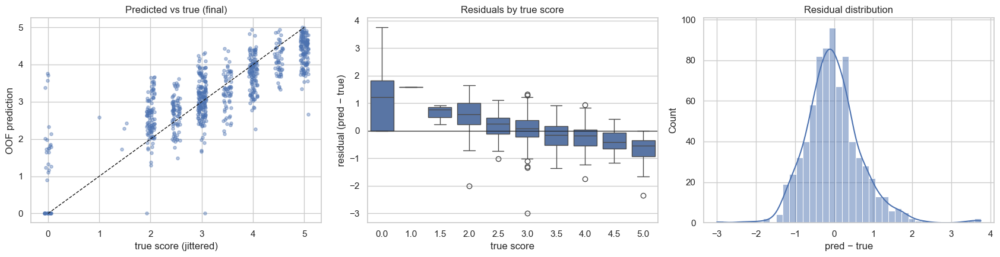
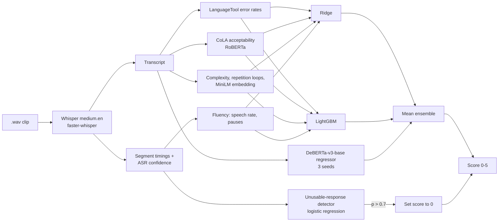
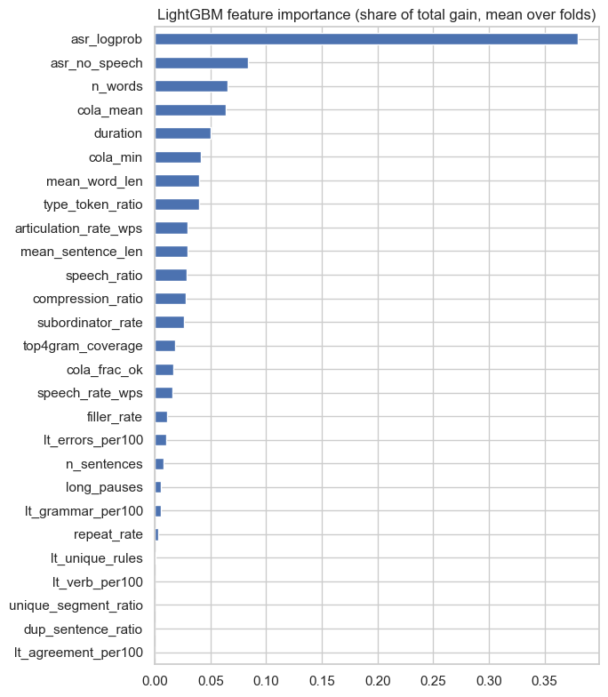

# SHL Hiring Assessment 2026: Grammar Scoring Engine for Spoken Audio

**Scores the grammar of 45–60 s spoken English answers (0–5) by transcribing them with Whisper and combining interpretable linguistic features with a fine-tuned DeBERTa regressor — final public-leaderboard RMSE 0.400.**

[](https://github.com/Akshatb848/shl-grammar-scoring-engine/actions/workflows/ci.yml)
[](LICENSE)




<sub>Figure from the executed notebook (section 7): out-of-fold predictions of the final model against the true score, residuals per score level, and the residual distribution. Only aggregate plots are shown; no competition audio or transcripts are included.</sub>

Predicts a continuous grammar score (0–5) for 45–60 second English speech recordings, for the
[SHL Hiring Assessment 2026](https://www.kaggle.com/competitions/shl-hiring-assessment-2026) Kaggle competition
(Kaggle user `akshatbanga`).

## Results

| Model | Training RMSE | CV RMSE (5-fold) | CV Pearson r | Public leaderboard (RMSE) |
|---|---|---|---|---|
| Ridge | 0.603 | 0.833 | 0.741 | 0.585 |
| LightGBM | 0.295 | 0.801 | 0.764 | 0.523 |
| DeBERTa-v3-base, fine-tuned (3 seeds) | 0.179 | 0.786 | 0.773 | 0.413 |
| Ensemble of the three | 0.304 | 0.729 | 0.814 | 0.419 |
| **Final: ensemble + unusable-response rule** | **0.325** | **0.713** | **0.819** | **0.400** |

## Approach

Grammar is a property of what is said, so each clip is transcribed with Whisper `medium.en`, then the text is
modelled two ways:

1. **Interpretable features** fed to Ridge and LightGBM: LanguageTool error rates, CoLA acceptability scores
   (RoBERTa), sentence complexity, fluency (speech rate, pauses, ASR confidence), Whisper repetition loops, plus a
   MiniLM sentence embedding for Ridge.
2. **DeBERTa-v3-base fine-tuned as a regressor** on the transcripts, averaged over 3 random seeds.

The three models are averaged. A separate logistic-regression detector, driven mainly by Whisper's confidence,
recognises unintelligible audio (the training set's score-0 clips) and sets the prediction to 0 when it is more than
70% sure. All models share the same 5 cross-validation folds.

The notebook's section 10 documents the experiments behind these choices: Whisper model size (large-v3 rewrites
speech into more fluent English and scores worse), how the leaderboard metric was identified as RMSE, the score-0
clips, seed averaging, and the prompt-relevance and loop features.

### Architecture



<details>
<summary>LightGBM feature importance (from the notebook)</summary>


</details>

### Tech stack

Python 3.10 · PyTorch 2.5 (CUDA 12.1) · Hugging Face Transformers (DeBERTa-v3, RoBERTa-CoLA) · sentence-transformers (MiniLM) · faster-whisper · language-tool-python · librosa / soundfile · scikit-learn · LightGBM · pandas / NumPy / SciPy · matplotlib / seaborn · Jupyter / nbformat

## Files

| File | Contents |
|---|---|
| `shl_grammar_scoring.ipynb` | **The submission notebook**: code, report, results and plots. The training-data RMSE is printed in section 7. |
| `build_notebook.py` | Generates the notebook from its cell sources (the notebook is built from this file, then executed). |
| `transcribe.py` | Resumable command-line Whisper transcription (same cache format as the notebook). |
| `finetune_deberta.py` | Command-line version of the notebook's DeBERTa fine-tuning (section 6b), resumable per fold and seed. |
| `run_all.ps1`, `run_deberta.ps1` | Windows launchers that run the long stages and restart them automatically if a process dies. |
| `requirements.txt` | Python dependencies. |
| `submission.csv` | The test-set predictions submitted to Kaggle (public leaderboard RMSE 0.400). |

## Reproducing

1. Python 3.10: `pip install -r requirements.txt` (PyTorch 2.5.1 with CUDA 12.1; `transformers` pinned below 4.50).
2. Java 8 or newer on `PATH`, for LanguageTool's local server, and a CUDA GPU with at least 4 GB of memory.
3. Download the competition data from Kaggle and unzip it into `data/` next to the notebook.
4. Run `shl_grammar_scoring.ipynb` top to bottom. The first run takes about an hour on an RTX 3050 Ti (Whisper
   transcription, then 3 seeds × 5 folds of DeBERTa fine-tuning). Every expensive step is cached under `cache/`, so
   later runs take a few minutes.

## Data

The competition data is not included, and the outputs of the three notebook cells that print transcripts of the
competition audio have been removed from this public copy, because the competition rules do not allow the data to
be shared outside the competition. Running the notebook with the data reproduces them.

Optional notebook settings (`WHISPER_MODEL`, `DROP_ZERO`, `DEBERTA_SEEDS`, `OUTPUT_DIR`) are listed in [`.env.example`](.env.example); export them in your shell before starting Jupyter. No API keys are needed.

## Repository checks and CI

```bash
pip install -r requirements-ci.txt
ruff check --select E9,F63,F7,F82 .
pytest -q
```

The full pipeline needs a CUDA GPU and the competition data, so CI runs lightweight checks instead: the committed notebook must be exactly what `build_notebook.py` generates (cell for cell), every notebook cell and script must parse, and `submission.csv` must have the Kaggle format (216 unique `.wav` rows, scores within 0–5). It does not re-train models or re-run the notebook.

## Limitations

- Results depend on the Kaggle competition data, which cannot be redistributed; reproducing them requires joining the competition.
- Training needs a CUDA GPU (developed on an RTX 3050 Ti, 4 GB) and Java for LanguageTool; the launchers `run_all.ps1` / `run_deberta.ps1` are Windows-only.
- The public leaderboard covers roughly 60% of the test set; CV RMSE (0.713) is computed on the 5-fold training split and is the more conservative estimate.
- Transcription normalises disfluencies, so some grammar errors in speech are invisible to the text models (see section 10 of the notebook).
- Most dependencies in `requirements.txt` are not version-pinned beyond PyTorch and `transformers`.

## License

[MIT](LICENSE) © 2026 Akshat Banga. The competition data is subject to the Kaggle competition rules and is not covered by this license.

## Author

**Akshat Banga** — [github.com/Akshatb848](https://github.com/Akshatb848) · Kaggle: `akshatbanga`
